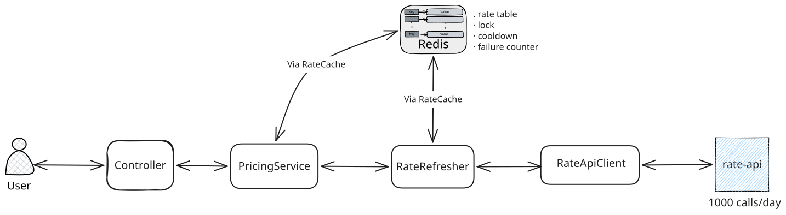
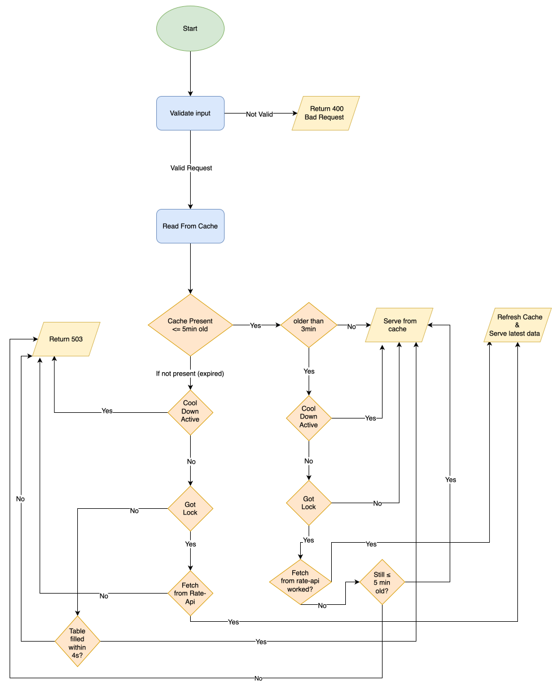

# Design

## Components

- **Controller**: Checks the params against the 36 allowed combinations. Returns the rate, a 400 for bad params, or a 503 with `Retry-After`.
- **PricingService**: Decides what to do for each request: serve the cached table, start a refresh, or wait for another request that is refreshing.
- **RateCache**: The class that talks to Redis. It reads and writes the rate table, and handles the lock, the cooldown and the failure counter.
- **RateRefresher**: Takes the lock, makes one upstream call then saves the new table or starts a cooldown if the call failed.
- **RateApiClient**: Sends one batch request for all 36 combinations with a 3s timeout and checks the response before it is used.
- **Redis**: Holds the rate table, the lock, the cooldown and the failure counter. In production, several app instances share this one Redis so there is one cache and one refresher across all of them.
- **rate-api**: The external pricing model. It allows 1000 calls a day per token and failed calls count too.

## Request flow

Notes:

- **Every 503 has a `Retry-After` header**: The cooldown time left or 5s if there is no cooldown. The `code` is `upstream_quota_exhausted` after the upstream sent a 429, otherwise `rates_unavailable`.
- **Redis down**: Any Redis error at any step gives a 503 with `cache_unavailable`. We never call rate-api without Redis, because without the lock and the cooldown every request could call it and burn the daily quota.
- **Still ≤ 5 min old?**: when a refresh fails, the old table is checked again before it is served. It might have been 4m58s old when the refresh started and 5m01s old when the refresh failed. In that case the user gets a 503, never a stale rate.
- **Waiting requests**: Never call rate-api and never try the lock again. They only read the cache every 200 ms for up to 4s.
